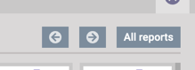
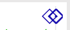
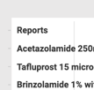
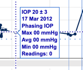
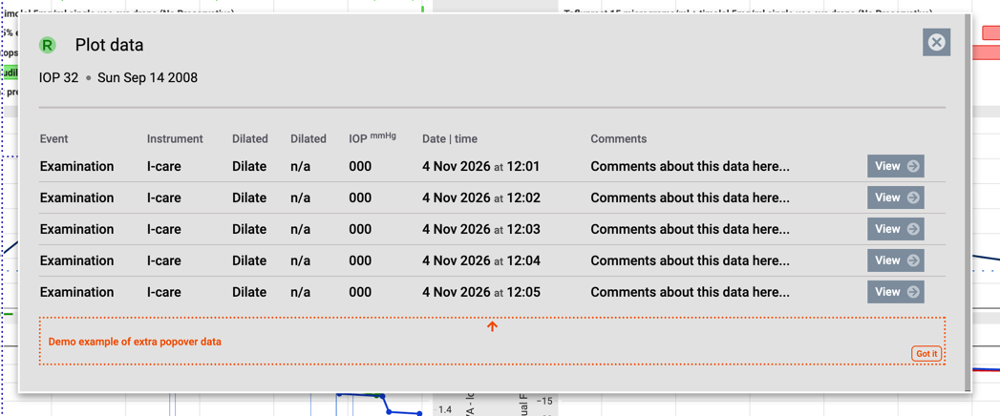
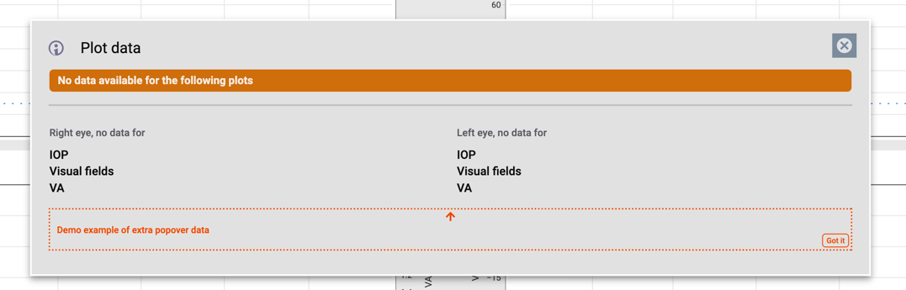
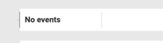

# Notes  

Updates/changes/notes from Reports UIX work and after feedback from David Haider

_(Sorry Sabi, a bit of brain dump but hopefully helpful!)_

## Requirements

- nxPlotJS 1.1.0 
- plotly-basic-4.1.2.min.js
- nxblu: 6.5.0 https://github.com/openeyes/nxblu/releases/tag/6.5.0

### OEScape DOM updates

Slight DOM change to support the Report UIX

```html
<div class="oes-split-grid split-1-1">
	<div class="oes-right-side">
		<div class="right-eye-plot">
			<!-- Plotly JS -->
		</div>
		<div class="reports-left-eye" hidden>
			<!-- Reports for left eye -->
		</div>
	</div>
	<div class="oes-left-side">
		<div class="left-eye-plot">
			<!-- Plotly JS -->
		</div>
		<div class="reports-right-eye" hidden>
			<!-- Reports for right eye -->
		</div>
	</div>
</div>
```

#### Reports (showing for Right Eye Reports)

Full UIX is now demo'd on iDG for Right and Left reports in all OEScapes on iDG (although, left only demos no reports to show). Isolated Reports UIX (no plots) is here:
https://idg.knowego.com/y26/oes-summary/reports-uix/

```html
<div class="reports-right-eye">
	<header class="oes-reports-header">
		<i class="oe-i lat-R"></i>
		<span class="fade">Reports</span>
		<b class="report-title">All (26)</b>
		<button type="button" class="btn-prev-report"><i class="oe-i direction-left-circle small"></i></button>
		<button type="button" class="btn-next-report"><i class="oe-i direction-right-circle small"></i></button>
		<button type="button" class="btn-all-reports">All reports</button>
	</header>

	<nav class="oes-report-grid show-all" data-side="right">

		<div class="date-report" data-side="right" data-report-date="2012-01-12" data-index="0">
			<div class="thumbnail">
				
			</div>
			<div class="date">12 Jan 2012</div>
		</div>

		... etc, etc for each report ...

	</nav>

	<div class="oes-view-report" hidden="">
		<!-- full report img here -->
		<div class="full-report-img"></div>
		<!-- any optional extra HTML for associated with shown report -->
		<div class="report-extra"></div>
	</div>
</div>
```

### Reports "mode"
Report mode is accessed by clicking either the "R" or "L" eye icon or by clicking on Report marker in the Plot.

#### Reports UIX is all controlled through Report dates:
- "Reports" marker in the Plot broadcasts a custom event
- Viewing a Report (via thumbnail or left/right arrow buttons/keys) broadcasts a custom event

For reference, iDG's demo JS for the Reports UIX is here but it will need updating for actual production usage and is not for production use:
[iDG reports UIX demo JS](idg_oescapeReports.js)

Navigating the Reports can be done via buttons, arrow keys or by clicking on a marker: 






Reports should always be shown first, at the top of the Events list




### Popover HTML / Extra data for markers 

Extra data for the markers can either be included in `customdata` 



` "customdata": [ Phasing IOP<br>Max 00 mmHg<br>Avg 00 mmHg<br>Min 00 mmHg<br>Readings: 0", etc ... `


Or, when marker is clicked show a Popover 
(click on any IOP marker in Glaucoma to see Popover demo)




### Empty data

An "empty" data UIX concept is demo'd here:
https://idg.knowego.com/y26/oes-summary/empty-data/

warn the User what data isn't available: 


No Events or Reports? then like this: 


for nxPlot pass this:
`allEvents: ["No events"],`


### Events

Lots of examples in the JSON files but generally:

If an Event is a "single" event then use this approach:

```JSON
{
  "event": "injection",
  "name": "Eylea 8mg",
  "x": [
    "2016-06-03",
    "2016-07-01",
    "2016-07-29"
  ],
  "y": [
    "Eylea 8mg",
    "Eylea 8mg",
    "Eylea 8mg"
  ]
}
```

but if it's a duration (drug, etc) then use this approach

```JSON
{
  "event": "durationBar",
  "name": "Acetazolamide 250mg modified release capsules",
  "xStart": "2017-10-01",
  "msDuration": 86400000,
  "y": ["Acetazolamide 250mg modified release capsules"],
  "customdata": ["01 Oct 2017<br>1 (drop), twice a day"]
}
```


